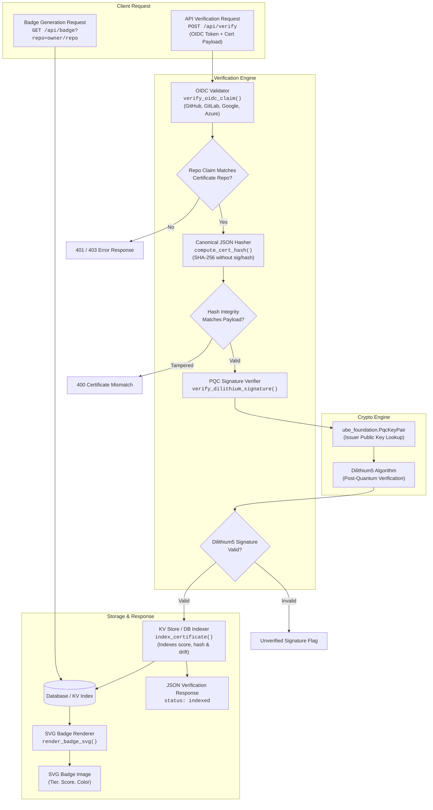

# NTI-1 Verified Badge


**A federated, post-quantum-signed compliance certificate system for AI agent repositories.**


[](https://pypi.org/project/nti-badge/)
[](https://opensource.org/licenses/Apache-2.0)


## What This Is


The NTI-1 Badge is not a badge. It is a protocol. It gives every AI agent repository a **portable, cryptographically signed compliance certificate** that any third party can verify offline. No subscription. No data lock-in. No central authority.


## Live Service


The live service is deployed at: **https://nti-badge-svs1.vercel.app**

- **Live Service:** https://nti-badge-svs1.vercel.app
- **Public Registry:** https://nti-badge-svs1.vercel.app/api/registry
- **Leaderboard:** https://nti-badge-svs1.vercel.app/api/leaderboard


## Installation


Install `nti-badge` from PyPI:

```bash
pip install nti-badge
```


## Python API Usage


Embed badge generation and certificate verification in your Python code:

```python
import nti_badge

# Render an SVG badge
svg_content = nti_badge.render_badge_svg(
    label="NTI-1",
    value="95/100 Platinum",
    color="#e5e4e2",
    tier_emoji="🏆"
)

# Parse and validate an NTI-Cert/1 certificate
cert = nti_badge.parse_certificate(cert_json_dict)

# Verify signature and cryptographic hash integrity offline
is_valid_sig = nti_badge.is_valid_signature(cert)
is_valid_hash = nti_badge.verify_cert_integrity(cert)
```


## What Makes It Different


| Traditional badge | NTI-1 Verified Badge |
|---|---|
| Self-reported score | OIDC + Dilithium5 signed |
| Vendor holds your data | Your repo holds the cert |
| GitHub only | GitHub, GitLab, Azure, Google, custom |
| Cannot verify offline | Verify with one command, no network |
| Centralized | Federated — anyone can mirror |
| Marketing PDF | Cryptographic proof |


## Your Certificate, Your Data


Every scan produces a `nti-certificate.json` file that lives in **your** repository — not on our servers. It is Dilithium5-signed, tied to a specific commit, and verifiable offline with a single command. This is why NTI is a neutral, federated standard: you own your compliance history forever. We only index a cryptographic hash so the world can see it. If NTI disappears tomorrow, your proof survives.


## Install in 2 Steps


### 1. Add the workflow


```yaml
name: NTI Verify
on: [push, pull_request]
permissions:
  id-token: write
  contents: read
jobs:
  verify:
    runs-on: ubuntu-latest
    steps:
      - uses: actions/checkout@v4
      - uses: abisheakp197/nti-badge@v1
      - name: Commit certificate
        run: |
          git config user.name "nti-bot"
          git config user.email "bot@nti.local"
          git add nti-certificate.json
          git commit -m "chore: NTI certificate [skip ci]" || true
          git push || true
```


### 2. Add the badge to your README


```markdown
[](https://nti-badge-svs1.vercel.app/repo.html?repo=your-org/your-repo)
```


## Verify Offline


Using `nti-scanner`:

```bash
pip install nti-scanner
nti-scanner verify ./nti-certificate.json
```

No network. No NTI servers. Just math.


## Federation


Any organization can run a mirror node. Read `/api/federation` for the manifest. Deploy this repo to Vercel, attach a KV store, announce your mirror.


## Endpoints


- `POST /api/verify` — submit cert for indexing
- `GET /api/badge?repo=owner/repo` — SVG badge
- `GET /api/certificate?repo=owner/repo` — index entry + history
- `GET /api/registry` — full index
- `GET /api/leaderboard` — top 50
- `GET /api/transparency` — append-only public log
- `GET /api/org?name=<org>` — org aggregate
- `GET /api/federation` — federation manifest


## The Certificate Spec


See [`docs/NTI-CERT-SPEC.md`](./docs/NTI-CERT-SPEC.md).


## License


Apache License 2.0. See LICENSE.


## Links


- PyPI Package: https://pypi.org/project/nti-badge/
- Live Service: https://nti-badge-svs1.vercel.app
- Public Registry: https://nti-badge-svs1.vercel.app/api/registry
- NTI-1 Spec: https://abisheakp197.github.io/nti-spec/
- nti-scanner: https://pypi.org/project/nti-scanner/
- ube-foundation: https://pypi.org/project/ube-foundation/


## Architecture


